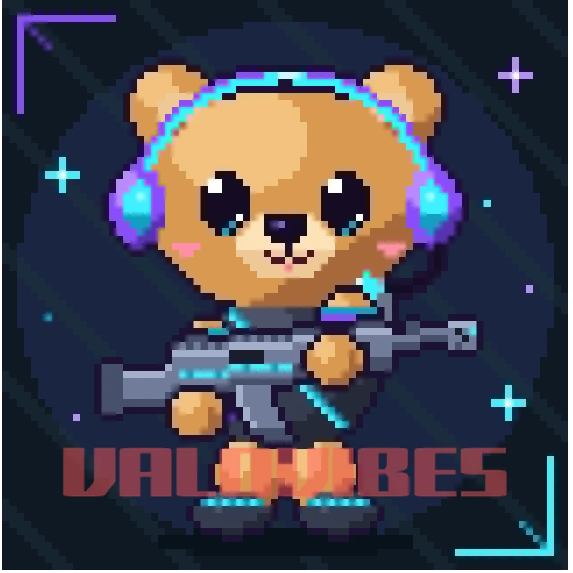

# 👥 Grupo 14 · TP3 — Dos sentencias, dos soluciones

<p align="center">
  
</p>

<p align="center">
  <strong>ValoVibes · Moderación y espera</strong><br>
  Front End · IFTS 29 · Asignación S12-C
</p>

> **Dos reglas, dos recorridos.** Una propuesta para cuidar las partidas y ayudar a cada jugador a encontrar su próximo equipo.

🌐 **Sitio publicado:** [ValoVibes · Grupo 14](https://trabajo-practico-nro3-grupal-frontend.vercel.app/)

ValoVibes conecta jugadores de Valorant con compañeros compatibles y coordina invitaciones. Esta landing presenta dos reglas de moderación y búsqueda, sus diagramas de flujo y simulaciones interactivas con datos de ejemplo.

## 🧭 La propuesta

### R5 · Pausa y revisión humana

| Etapa | Comportamiento propuesto |
| --- | --- |
| **Condición** | Una sesión tiene un reporte grave pendiente de revisión. |
| **Protección** | Se pausan nuevas invitaciones e incorporaciones a esa sesión. |
| **Revisión** | El reporte pasa a moderación humana. El sistema no determina sanciones. |
| **Si no se cumple** | La sentencia no define ese caso. La propuesta mantiene el recorrido habitual y lo presenta como decisión de diseño. |

### R6 · Búsqueda con filtros bajo control del jugador

| Situación | Comportamiento propuesto |
| --- | --- |
| **Hay coincidencias** | Se muestran sesiones activas que coinciden con los filtros actuales. |
| **No hay coincidencias** | Se informa el resultado y se ofrece ajustar los filtros, sin modificarlos por cuenta propia. |
| **Sesión pausada** | No aparece como disponible para nuevos compañeros. |
| **Búsqueda no habilitada** | No se consultan resultados ni se cambian los filtros. |

La sentencia R6 define el caso sin resultados. La presentación de coincidencias activas y la espera cuando no hay una búsqueda habilitada son decisiones de diseño del equipo.

## 🧪 Simulaciones

Las simulaciones permiten probar las condiciones de R5 y R6 desde la página, sin cuenta ni conexión a un servicio:

- **R5:** elegí si el reporte es grave y si sigue pendiente de revisión. Si se cumplen ambas condiciones, se muestra la pausa de invitaciones e incorporaciones y la derivación a moderación humana, sin sanción automática. Si no, se aclara que la sentencia no define ese caso.
- **R6:** elegí si el jugador está habilitado y los filtros de rol y región. La búsqueda compara esos filtros con perfiles ficticios locales, excluye siempre las sesiones pausadas y muestra las coincidencias o informa que no hay resultados.
- **Control del jugador:** ante una búsqueda sin coincidencias, la interfaz ofrece enfocar los filtros para que el jugador decida si quiere ajustarlos; no los cambia automáticamente.

Los perfiles y las respuestas son una demostración de la lógica en el navegador; no representan jugadores reales ni consultan o modifican sesiones de un servidor.

## 🎨 Diseño y experiencia

- **Identidad:** azul noche y negro para las superficies; amarillo para destacar acciones y decisiones; blanco frío para la lectura y coral para el recorrido de moderación.
- **Jerarquía:** titulares grandes, explicaciones directas y diagramas con decisiones, ramas SÍ/NO y conectores visibles. Al probar un escenario, se resalta el camino elegido.
- **Navegación:** menú superior con indicador de sección activa para ubicar el recorrido mientras se avanza por la página.
- **Adaptación:** la composición se reorganiza para pantallas pequeñas y apila las ramas de los diagramas en móvil.
- **Accesibilidad:** controles con etiquetas, resultados anunciados por lectores de pantalla, navegación por teclado, enlace para saltar al contenido y respeto por la preferencia de movimiento reducido del dispositivo.

## 🛠️ Tecnologías

| Tecnología | Uso |
| --- | --- |
| **HTML5** | Estructura semántica de la landing, los recorridos, los formularios y sus detalles. |
| **CSS3** | Paleta, tipografía, diagramas, diseño adaptable, conectores, transiciones y resaltado de caminos. |
| **JavaScript** | Simulación de las reglas R5/R6 con datos de ejemplo, resultados accesibles, desplegables e indicador de sección activa. |
| **Google Fonts** | Barlow Condensed para titulares y Manrope para lectura e interfaz. |

El proyecto está hecho con tecnologías web nativas. No usa framework ni paquetes. Las simulaciones se ejecutan en el navegador con datos locales: no hay backend, inicio de sesión ni conexión a partidas.

## ⚙️ Interacciones

- Los enlaces del menú llevan a la presentación, moderación y búsqueda.
- El menú resalta la sección visible durante el desplazamiento.
- **Ver detalle de R5** y **Ver detalle de R6** despliegan datos de entrada, casos y decisiones de diseño.
- **Probar escenario** en R5 permite recorrer los casos con y sin reporte grave pendiente.
- **Buscar coincidencias** en R6 permite activar o desactivar la búsqueda y filtrar los perfiles de ejemplo por rol y región. Si no hay resultados, **Ajustar mis filtros** lleva el foco a los controles sin cambiar sus valores.
- Los diagramas y sus detalles siguen disponibles sin JavaScript; las simulaciones requieren JavaScript.

## 🚀 Cómo abrirlo

- **Sitio publicado:** [ValoVibes · Grupo 14](https://trabajo-practico-nro3-grupal-frontend.vercel.app/)
- **En tu computadora:** descargá el proyecto y abrí `index.html` en un navegador moderno con JavaScript habilitado para usar las simulaciones.

## 📁 Estructura del proyecto

```text
.
├── index.html                 # Landing y recorridos R5/R6
├── styles.css                 # Estilos, paleta y adaptación responsive
├── script.js                  # Simulaciones, navegación activa y paneles de detalle
├── assets/
│   └── valovibes-logo.png     # Logo de ValoVibes
└── README.md                  # Documentación del proyecto
```

## 👥 Equipo · Grupo 14

| Integrante | Rol |
| --- | --- |
| **Carlos Marcelo Hernandez** | Coordinar las instrucciones al agente y revisar la coherencia entre la consigna y la landing. |
| **Valeria Noemi Fernandez** | Analizar R5 y revisar la pausa y la derivación a moderación humana. |
| **Micaela Laila Gargiulo** | Analizar R6 y revisar los caminos con y sin coincidencias. |
| **Dámaris Rodriguez** | Revisar la presentación visual, navegación y desplegables; organizar la documentación. |

### Revisión entre integrantes

#### Carlos Marcelo Hernandez · Revisión general

Contrasta la landing con la consigna y comprueba que aparezcan la startup, el bloque S12-C, las dos reglas y sus recorridos. Al revisar R5, advierte que la rama “no” podría leerse como si la regla definiera qué debe pasar. Propone aclarar que la sentencia no define ese caso y que continuar el flujo habitual es una decisión de diseño.

#### Valeria Noemi Fernandez · Revisión de R5

Compara el flujo con la redacción original. Comprueba que la condición incluya tanto la gravedad del reporte como que siga pendiente de revisión, y que la respuesta incluya pausa y derivación humana sin sanción automática. Propone mantener esos dos datos como entradas y hacer explícito que una persona revisa el caso.

#### Micaela Laila Gargiulo · Revisión de R6

Recorre los casos con coincidencias, sin coincidencias y con búsqueda no habilitada. Señala que una sesión pausada no puede contarse como disponible y que los filtros deben permanecer bajo control del jugador. Propone mostrar sólo sesiones activas compatibles, ofrecer ajustes sin cambiar filtros y esperar cuando no corresponda buscar.

#### Dámaris Rodriguez · Revisión visual y de navegación

Revisa la lectura en desktop y móvil. Detecta exceso de rótulos pequeños y recuadros, poca jerarquía entre pasos y que la identificación del grupo no destacaba al inicio. Propone reducir elementos visuales, dar más espacio a los flujos, simplificar la navegación y hacer visible “IFTS 29 · Grupo 14” bajo el nombre de ValoVibes.

**Resultado:** El equipo acuerda conservar la lógica de ambas sentencias, marcar como decisión de diseño cualquier alternativa no especificada y simplificar la presentación para que las condiciones, decisiones y resultados se distingan con claridad.

## 🤖 Herramientas de IA, aplicaciones y modelos utilizados

| Aplicación | Modelo | Uso en el trabajo |
| --- | --- | --- |
| **Codex para escritorio** | **GPT-6** | Analizar la consigna, organizar la propuesta R5/R6, crear y editar la landing en HTML, CSS y JavaScript, y redactar esta documentación. |

### Construcción agéntica y aportes del grupo

Codex recibió la consigna del TP3 y la asignación de **ValoVibes, grupo 14, S12-C**. A partir de ese material, el agente revisó las sentencias, propuso los recorridos, generó los archivos del sitio e incorporó los cambios solicitados durante las revisiones. El grupo aportó la dirección del proyecto, indicó qué aspectos quería mejorar y evaluó cada resultado para orientar la siguiente iteración.

La distribución de roles cubre coordinación y revisión general, análisis de R5, análisis de R6, revisión visual y de navegación, y documentación. La revisión cruzada muestra cómo registrar una observación y una mejora concreta.

### Evidencia de iteración

1. **Instrucción inicial:** crear la landing a partir de la consigna para **ValoVibes, grupo 14**.
2. **Primer pedido de mejora:** el grupo pidió un diseño más moderno y original. Después señaló que la paleta beige no tenía coherencia, los diagramas se veían mal y los textos de lectura eran pequeños.
3. **Corrección solicitada:** conservar el amarillo, ordenar los flujos, mejorar la legibilidad y quitar elementos visuales repetidos. En otras revisiones, el grupo pidió reducir las tarjetas, modernizar el menú, integrar el bloque de presentación al fondo de la página, retirar la línea y la leyenda bajo el hero y mostrar el grupo 14 en el encabezado.
4. **Qué cambió y por qué:** se ajustaron proporciones y tamaños de texto; se redujeron recuadros, rótulos y separadores; se actualizó el menú con una marca para la sección activa; se integró la presentación al fondo general; y se colocó **IFTS 29 · Grupo 14** bajo el nombre de ValoVibes. Estos cambios buscan dar más jerarquía a los recorridos y reducir el ruido visual sin quitar la información necesaria para entender R5 y R6.

El equipo también indicó que la segunda frase del título de R6 no necesitaba otro color ni un peso tipográfico distinto; se dejó en negro, como la primera. Las respuestas que amplían lo definido por las sentencias se identifican en la landing como decisiones de diseño del equipo.

## 📚 Créditos

ValoVibes es una startup ficticia creada por estudiantes del **IFTS 16**. El logo y las sentencias R5/R6 se tomaron de la consigna oficial **“TP3 · Dos sentencias, dos soluciones · IFTS 29”**.

Proyecto académico realizado para la materia **Frontend del IFTS 29**.
